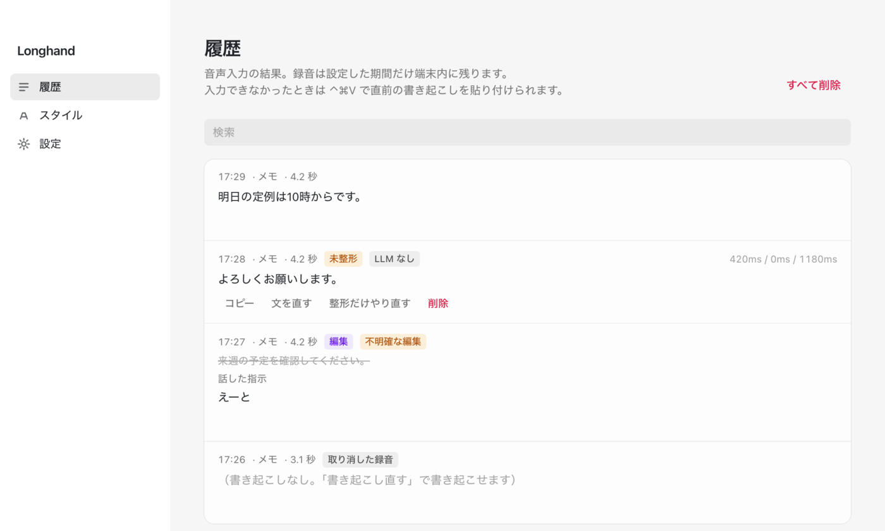
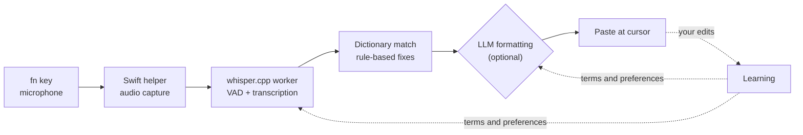

<p align="center">
  <picture>
    <source media="(prefers-color-scheme: dark)" srcset="assets/logo-dark.svg">
    
  </picture>
</p>

<p align="center">
  <strong>Local-first voice dictation for Japanese.</strong><br>
  Hold a key, speak, and clean, punctuated text appears at your cursor. Your voice never leaves your Mac.
</p>

<p align="center">
  <a href="LICENSE"></a>
  
  
  
  
</p>

<p align="center">
  <a href="#features">Features</a> |
  <a href="#how-it-works">How it works</a> |
  <a href="#accuracy">Accuracy</a> |
  <a href="#privacy">Privacy</a> |
  <a href="#getting-started">Getting started</a> |
  <a href="docs/architecture.md">Architecture</a>
</p>

---

Longhand is a push-to-talk dictation app for macOS, built for people who write Japanese all day and mix it with English product names, code terms and numbers.
Speech recognition runs on your Mac with [whisper.cpp](https://github.com/ggml-org/whisper.cpp).
An LLM of your choice then removes fillers, fixes mishearings and punctuates the text, and the result is typed into whatever app has focus.
The LLM step is optional: turn it off and Longhand works fully offline.

<p align="center">
  
</p>

## Features

- **Push to talk, anywhere.** Hold `fn` and speak. Release, and the text is inserted at the cursor of the active app. Double-tap `fn` (or `fn` + `Space`) for hands-free mode, `esc` to cancel.
- **On-device speech recognition.** Whisper large-v3-turbo (8-bit quantized) on Metal, with Silero VAD. A five-second utterance is transcribed in about 0.45 s on an M5 Mac.
- **Tuned for Japanese.** Written-style punctuation, numerals, and Japanese-English spacing follow Japanese conventions. Katakana renderings of technical terms are restored to their Latin spelling (`クバネティス` to `Kubernetes`).
- **LLM formatting you control.** Removes fillers and false starts, repairs homophones from context, and keeps your wording otherwise. Works with Anthropic, OpenAI-compatible endpoints (LiteLLM, vLLM, Ollama, LM Studio), Azure OpenAI, or any HTTP endpoint.
- **Edit by voice.** Select text, hold the key and say an instruction such as "もっと丁寧に" to rewrite the selection.
- **Learns from your corrections.** When you fix the inserted text, Longhand picks up new terms, common mishearings, notation preferences and phrases it should not rewrite. Every learned item is shown and can be undone.
- **Custom dictionary and replacements.** Terms in the dictionary are passed to the recognizer as hints and to the formatter as spelling references.
- **Fails safe.** If the LLM is slow or unreachable, the raw transcript is inserted instead. Where there is no text field, `⌃⌘V` pastes the last result.

## How it works



1. A small Swift helper watches the hotkey, records the microphone, reads the text around the cursor, and pastes the result.
2. A worker process transcribes the audio locally. Dictionary terms are given to Whisper as hints, and only the hint-induced changes that hold up are kept, so unrelated speech is not distorted.
3. Rule-based fixes run without any network: reading-based dictionary matches, katakana-to-Latin term restoration and particle repairs, using a Japanese tokenizer.
4. The formatter LLM receives the transcript and a little context, and returns the cleaned-up text. Low-confidence spans are flagged so the model knows where to look.
5. The text is inserted, and for a short while Longhand watches for your corrections to learn from them.

See [docs/architecture.md](docs/architecture.md) for the full design.

## Accuracy

Character error rate on content (punctuation ignored), measured with the same code path the app uses.

| Dataset | Utterances | Speech recognition only | After formatting |
|---|---|---|---|
| [FLEURS](https://huggingface.co/datasets/google/fleurs) Japanese, read speech | 135 | 4.20% | 2.59% |
| Technical-term script, synthetic speech | 180 | 7.96% | 1.67% |
| Disfluent speech (fillers, self-corrections), synthetic speech | 156 | 11.01% | 2.38% |

Formatting used Claude Opus 5.5 at low effort (median response 1.3 s).
References for the disfluent set are the intended clean sentences, so the first column includes the fillers that formatting is expected to remove.
On FLEURS, formatting improved 43 utterances and made 3 worse.
The evaluation harness, the datasets it can build, and the experiments that were tried and rejected are described in [docs/evaluation.md](docs/evaluation.md).

## Privacy

- **Audio stays on your Mac.** Recognition is local. Recordings are kept for 72 hours by default (configurable) and then deleted.
- **Text goes only where you point it.** If formatting is on, the transcript is sent to the LLM endpoint you configured, together with the app name, the browser domain and the text around the cursor (300 characters on each side while dictating, up to 1,000 when editing a selection). Each of these can be turned off. Password fields are never read.
- **No telemetry, no update checks, no crash reporting.** The UI process is blocked from making network requests at all. With formatting off, Longhand opens no network connections.
- **Model downloads are explicit.** The Whisper model (835 MB) is fetched from Hugging Face only when you press the download button, and its SHA-256 is verified.
- **Logs contain no transcripts and no keys.** The API key is encrypted with the macOS keychain.

## Getting started

Longhand is pre-1.0 and has no prebuilt releases yet. Build it from source:

**Requirements**

- A Mac with Apple Silicon, macOS 14 or later
- Node.js 24 and npm
- Xcode with Swift 6, and CMake

```sh
git clone https://github.com/ponyo877/longhand.git
cd longhand
npm install
npm run build:native   # Swift helper and speech recognition workers
npm start              # run in development mode
```

On first launch, the onboarding window asks for microphone and accessibility permissions and downloads the speech model.
Then open **Settings > Connection** to choose an LLM endpoint, or leave it off to insert raw transcripts.

To build a distributable app:

```sh
npm run make           # .dmg and .zip in out/make/
```

Building the optional Apple SpeechTranscriber worker requires Xcode 26. Without it, run `npm run build:helper && bash asr/build.sh whisper`.

## Configuration

**LLM endpoint**

| Your endpoint | Choose | Notes |
|---|---|---|
| Anthropic API or a compatible proxy | Anthropic | Leave the URL empty for the official API |
| OpenAI API, LiteLLM, vLLM, Ollama, LM Studio | OpenAI-compatible | Base URL such as `http://localhost:11434/v1` |
| Azure OpenAI | Azure OpenAI | Resource URL and deployment name |
| Anything else | Custom HTTP | Request body template and a path to the text in the response |

Requests follow the system proxy settings and trust the certificates in your keychain.

**Speech recognition engine**

| Engine | Notes |
|---|---|
| Whisper large-v3-turbo (default) | Most accurate |
| Apple SpeechTranscriber | macOS 26 or later. Fast and needs no download from Longhand, but less accurate |
| Parakeet (Japanese) | Fast, least accurate of the three |

**Where data lives**

| What | Location |
|---|---|
| Settings, dictionary, history | `~/Library/Application Support/Longhand/` |
| Recordings | `~/Library/Application Support/Longhand/recordings/` |
| Speech models | `~/Library/Application Support/Longhand/models/` |
| Logs | `~/Library/Logs/Longhand/` |

## Troubleshooting

- **`fn` opens the emoji picker.** In System Settings > Keyboard, set "Press 🌐 key to" to "Do Nothing".
- **Nothing is inserted.** Check the accessibility permission. After rebuilding, you may need to toggle it off and on.
- **The same text is typed twice, or the hotkey does nothing.** Another dictation app may be listening on the same key. Longhand logs `rival_in_front` when another app intercepts key events first.
- **Text is not formatted.** Use the Test button in Settings > Connection to see the error and the response time.

## Project status

Longhand works day to day on the author's machine, and the core pipeline is covered by 649 unit and integration tests plus 87 Swift tests.
It is still early:

- macOS on Apple Silicon only. The UI is in Japanese.
- No signed or notarized releases yet.
- Speed has been measured on an M5 Mac only.

Bug reports and pull requests are welcome. See [CONTRIBUTING.md](CONTRIBUTING.md).

## Acknowledgements

Longhand builds on [whisper.cpp](https://github.com/ggml-org/whisper.cpp), [OpenAI Whisper](https://github.com/openai/whisper), [Silero VAD](https://github.com/snakers4/silero-vad), [Lindera](https://github.com/lindera/lindera), [FluidAudio](https://github.com/FluidInference/FluidAudio) and [Electron](https://www.electronjs.org/).
Several ideas were learned from other open-source dictation apps, including Hex, [Amical](https://github.com/amicalhq/amical), OpenWhispr and [Handy](https://github.com/cjpais/handy).
Third-party licenses are listed in [THIRD_PARTY_NOTICES.md](THIRD_PARTY_NOTICES.md).

## License

[MIT](LICENSE)
