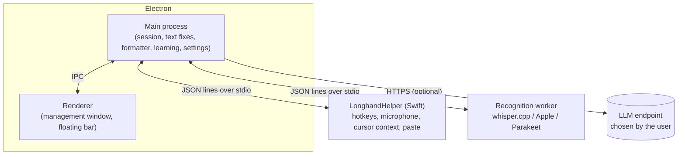

# Architecture

Longhand is an Electron app with two native companions: a Swift helper that talks to macOS, and speech recognition workers that run the models.
Everything except the optional LLM call happens on the user's Mac.

## Processes

| Process | Language | Responsibility |
|---|---|---|
| Main | TypeScript (`src/main/`) | Owns the dictation session and all text processing. Starts and supervises the other processes |
| Renderer | React (`src/renderer/`) | Management window (history, style, settings, onboarding) and the floating bar. Sandboxed, with no network access |
| LonghandHelper | Swift (`helper/`) | Global hotkeys through an event tap, audio capture at 16 kHz, reading the focused text field through the Accessibility API, pasting |
| Recognition worker | C++ or Swift (`asr/`) | Loads a model once and transcribes PCM on request. One worker binary per engine |

The helper and the workers speak newline-delimited JSON over stdin and stdout.
The message types are defined in `src/shared/protocol.ts` and `src/shared/asr-protocol.ts`.
If a recognition worker exits, the main process restarts it with backoff and reloads the model.

## The dictation pipeline

1. **Record.** The helper reports key down and streams audio chunks. After key up it keeps recording for a short tail (300 ms by default) so that sentence endings are not cut off.
2. **Transcribe.** The whisper worker trims leading and trailing silence with Silero VAD and decodes greedily with timestamps. Long recordings are transcribed in segments while the user is still speaking, so the wait after release covers only the last segment.
3. **Use the dictionary carefully.** Dictionary terms are passed to Whisper as a prompt. Because hints can also distort unrelated speech, the default mode transcribes twice (with and without hints) and keeps only the spans where the hinted result contains a dictionary term.
4. **Fix without a network.** `src/main/vocab/` matches the transcript against dictionary readings using a Japanese tokenizer. `src/main/textfix/` restores Latin spellings of common technical terms from their katakana form and repairs particles. Token confidences from Whisper decide which fixes are safe.
5. **Format.** `src/main/format/` builds a prompt with fixed rules in the system message (cacheable) and the transcript plus context in the user message. The model may remove fillers and self-corrections, punctuate, apply notation rules, and repair clear mishearings. It is told to leave wording alone otherwise. Low-confidence spans, dictionary candidates and past corrections are passed as evidence.
6. **Insert.** The helper pastes the text and verifies that it landed. If the LLM fails or times out, the unformatted text is inserted instead.
7. **Learn.** For a short time after pasting, the helper watches the text field. If the user edits the inserted text, `src/main/learn/` classifies the edit and stores it.

## Learning from corrections

| Kind | Example | How it is used later |
|---|---|---|
| New term | `ぐらふぁな` corrected to `Grafana` | Added to the dictionary: a hint for the recognizer and a spelling reference for the formatter |
| Misheard form | `クバネテス` corrected to the dictionary term `Kubernetes` | Stored as an alternative reading of that term |
| Correction pair | `公正` corrected to `校正` | When the same form appears again, the pair is shown to the formatter, which decides from context |
| Kept phrase | The formatter changed `一つ` to `1つ` and the user changed it back | The formatter is told not to rewrite that phrase |

Every learned item is announced with a notification and can be undone.

## Network model

- The renderer session blocks every request that is not an app resource (`src/main/net/egress.ts`).
- LLM calls go through a dedicated session that follows the system proxy settings and keychain certificates.
- Model downloads use a separate session and happen only when the user presses the download button. Files are pinned to a revision and verified by SHA-256.
- There is no telemetry, update check or crash reporting.

## Storage

All data is local, under `~/Library/Application Support/Longhand/`:

- `settings.json`: settings. The API key is encrypted with Electron `safeStorage`, which uses a key in the macOS keychain.
- `history.json`: the last 100 results.
- `recordings/`: audio of recent dictations, deleted after 72 hours by default.
- `models/`: speech models.

Logs are written to `~/Library/Logs/Longhand/`. They contain timings and states, never transcript text or keys.

## Permissions

| Permission | Why |
|---|---|
| Microphone | Recording |
| Accessibility | The global hotkey, reading the text around the cursor, and pasting |

The helper is a separate signed app bundle so that the permissions stay attached to it across rebuilds.
